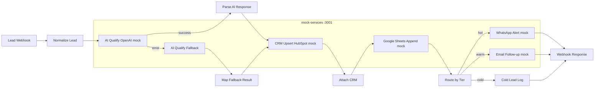

# n8n Lead Automation Demo

Portfolio-ready demo of an **n8n** lead pipeline: webhook intake → AI qualification (with fallback) → CRM + spreadsheet logging → tier-based routing (WhatsApp / email). All integrations are **mocked**; no API keys or real credentials.

## Architecture



## Quick start

**Requirements:** Docker with Compose v2.

```bash
sudo docker compose up --build -d
# Wait ~45s for n8n import + publish on first boot
chmod +x scripts/*.sh
./scripts/sample-leads.sh
```

If the webhook 404s after an upgrade, republish:

```bash
./scripts/activate-workflow.sh
```

n8n reaches mocks via `host.docker.internal:3001` (workaround for bridge networking in some cloud VMs).

- **n8n UI:** http://localhost:5678  
- **Webhook:** `POST http://localhost:5678/webhook/lead`  
- **Mock logs:** http://localhost:3001/logs  

Stop: `docker compose down` (add `-v` to reset n8n data).

## Per-node notes

| Node | Role |
|------|------|
| **Lead Webhook** | `POST /webhook/lead` entry; responds via **Webhook Response** when the run finishes. |
| **Normalize Lead** | Maps body fields (`name`, `email`, `company`, `budget_usd`, `phone`, `source`) and demo flags (`force_tier`, `simulate_openai_failure`). |
| **AI Qualify (OpenAI mock)** | HTTP POST to mock OpenAI `/v1/chat/completions`; on failure continues on the error output. |
| **Parse AI Response** | Code node: parses assistant JSON (`score`, `tier`, `summary`, `reasons`). |
| **AI Qualify Fallback** | Rules-based scorer when the primary AI call fails (or `simulate_openai_failure: true`). |
| **Map Fallback Result** | Shapes fallback output like the primary qualification path. |
| **CRM Upsert (HubSpot mock)** | Fake HubSpot/GHL upsert; returns `crm_*` id for downstream steps. |
| **Attach CRM** | Merges CRM metadata with the qualified lead record. |
| **Google Sheets Append (mock)** | Appends a row to a fake “Leads” sheet (logged server-side). |
| **Route by Tier** | Switch: `hot` → WhatsApp, `warm` → email, else cold archive. |
| **WhatsApp Alert (mock)** | Queues a fake WhatsApp message for hot leads. |
| **Email Follow-up (mock)** | Queues a fake nurture email for warm leads. |
| **Cold Lead Log** | Tags cold leads without outbound alerts. |
| **Webhook Response** | JSON summary: tier, score, `crm_id`, routing outcome. |

## Sample payload

```json
{
  "name": "Amina Hassan",
  "email": "amina@example.com",
  "company": "Global Enterprise Partners",
  "budget_usd": 42000,
  "phone": "+14155550101",
  "source": "referral"
}
```

Set `"simulate_openai_failure": true` to exercise the fallback branch.

## Repository layout

```
workflows/lead-automation.json   # Exported n8n workflow
mock-services/                   # Tiny HTTP mocks (AI, CRM, sheets, WhatsApp, email)
n8n/docker-entrypoint.sh         # Import workflow on first boot + activate
scripts/sample-leads.sh          # Curl demo leads
scripts/activate-workflow.sh     # Manual activation helper
docker-compose.yml
```

## Upwork portfolio context

Demonstrates webhook-driven automation, resilient AI integration (primary + fallback), CRM/spreadsheet side effects, and conditional outbound routing—typical of client lead-gen stacks, runnable locally without paid SaaS accounts.
